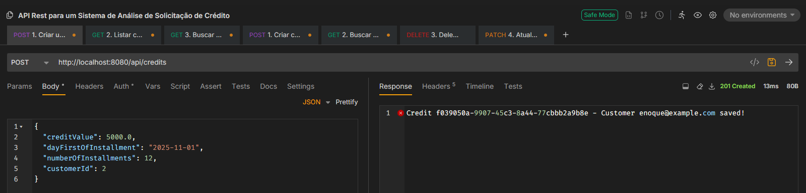
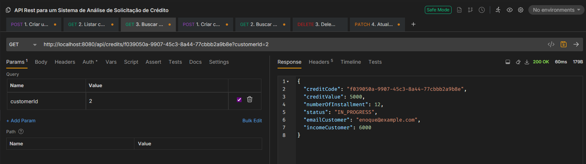
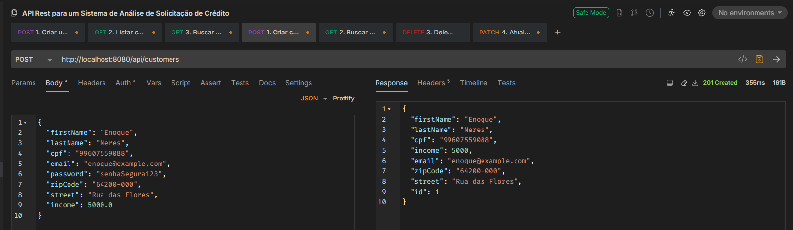

<h1>request-credit-system</h1>

API Rest para um Sistema de Análise de Solicitação de Crédito

     
    
    
    
    
    

<figure>

   
  Diagrama UML Simplificado de uma API para Sistema de Avaliação de Crédito

</figure>

✅ 1. Descrição do Projeto

API REST desenvolvida em Kotlin com Spring Boot para gerenciamento de clientes e créditos financeiros. Permite criar, consultar, atualizar e deletar clientes, além de registrar e buscar créditos vinculados a cada cliente.

🚀 2. Como rodar o projeto localmente

#### Clonar o repositório
<li>git clone https://github.com/enqneres/credit-application-system.git

#### Abrir no IntelliJ e rodar a aplicação
<li>Execute o comando: <code>./gradlew bootrun</code></li>

<h6>** Visando facilitar a demostração da aplicação, recomendo instalar apenas o IntelliJ IDEA e executar o projeto através da IDE **</h6>

🔧 3. Endpoints disponíveis

#### 📍 Clientes (`/api/customers`)
| Método | Endpoint | Descrição |
|--------|----------|-----------|
| `POST` | `/api/customers` | Cria um novo cliente |
| `GET` | `/api/customers/{id}` | Busca cliente por ID |
| `PATCH` | `/api/customers?customerId={id}` | Atualiza dados do cliente |
| `DELETE` | `/api/customers/{id}` | Deleta cliente |

#### 📍 Créditos (`/api/credits`)
| Método | Endpoint | Descrição |
|--------|----------|-----------|
| `POST` | `/api/credits` | Cria um novo crédito para um cliente |
| `GET` | `/api/credits?customerId={id}` | Lista todos os créditos de um cliente |
| `GET` | `/api/credits/{creditCode}?customerId={id}` | Busca um crédito específico por código |

🧪 4. Exemplos de requisição

📚 5. Tecnologias utilizadas
- Kotlin
- Spring Boot
- Gradle
- JPA / Hibernate
- Banco de dados H2

👤 6. Autor

Desenvolvido por [Enoque Neres]()

---

<h3>Referências</h3>

Projeto executado por meio da plataforma da DIO de autoria da Camila Cavalcante

Link do repositório original: https://github.com/cami-la/credit-application-system.git

